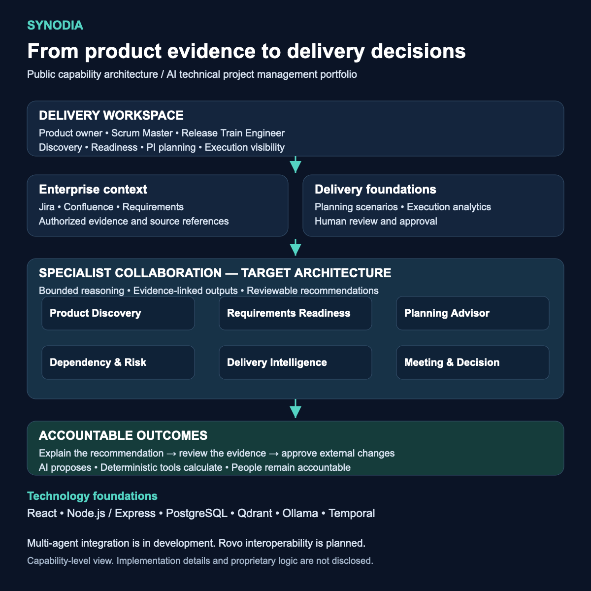

# Synodia — AI-enabled delivery management

**A product-development case study in AI technical project management, evidence-led planning and governed automation.**

Synodia explores how product owners, Scrum Masters and Release Train Engineers can connect requirements, planning decisions and delivery progress in one workspace. It builds on a working PI-planning application and is evolving toward specialist-agent collaboration.

This public portfolio explains the product direction and delivery approach. Application source, customer information and proprietary implementation details are not included.

## Why this project

Requirements, Jira work, capacity assumptions and delivery decisions often live in different places. Synodia aims to help delivery leaders answer:

- What are we committing to, and which requirements support it?
- What changed after commitment?
- Which dependencies or missing evidence need attention?
- What can AI recommend, and which actions need human approval?

## My role and working approach

I am developing Synodia as a hands-on product initiative, defining requirements, prioritizing delivery increments, reviewing architecture choices and validating the user experience. I use AI-assisted development to support implementation and troubleshooting, while retaining responsibility for product decisions and acceptance.

The project illustrates the areas I want to bring to an **AI Technical Project Manager** role:

| Management capability | Evidence in this initiative |
|---|---|
| Product discovery and scope | Translate delivery pain points into journeys, readiness checks and reviewable features |
| Technical planning | Separate business workflows, AI reasoning, evidence retrieval and deterministic calculations |
| Risk and governance | Require human approval for Jira writes; track access-control and recovery limitations |
| Incremental delivery | Build working foundations before integrating the complete specialist-agent suite |
| Quality and acceptance | Use regression tests, evidence checks and explicit release gates |
| Stakeholder communication | Explain available capabilities, roadmap items and uncertainties separately |

## Product capability snapshot

| Area | Current position |
|---|---|
| PI planning | Implemented foundation: teams, sprints, capacity, backlog and planning scenarios |
| Jira integration and governance | Imports and governed write proposals implemented; broader role/scope enforcement and live acceptance remain incomplete |
| PI execution | Initial cockpit: objectives, features, sprint execution, dependencies, risks, scope changes and freshness |
| Delivery analytics | Lean value-flow, Kanban, Scrum and Waterfall perspectives; EVM uses explicitly supplied baseline/progress/cost inputs |
| Product discovery | Requirements ingestion, retrieval, evidence-linked journeys and reviewable gaps implemented |
| Durability and recovery | Workflow, backup and deletion foundations implemented; deployment-specific configuration and acceptance remain |
| Multi-agent collaboration | Shared contracts and bounded coordinator foundation; full specialist integration is under development |
| Atlassian Rovo | Planned exploration; no implemented integration or partnership claim |

“Implemented” describes source-level capability, not enterprise certification or production readiness.

## Public architecture view

The diagram shows capability boundaries and the intended collaboration model. It deliberately omits implementation topology, private algorithms, prompts, schemas and execution rules.

**Existing technology foundations:** React, Node.js/Express, PostgreSQL, Qdrant, Ollama and Temporal.

**AI concepts:** retrieval-augmented generation, hybrid retrieval, optional reranking, evidence grounding, tool use, bounded execution and human review. Versioned artifact exchange is the intended collaboration model.

**Planned extensions:** LangGraph-based specialist execution, evaluation of vLLM/private inference, and optional Atlassian Rovo integration through MCP/Forge. These are roadmap choices, not deployed capabilities.

> Agents propose. Deterministic tools calculate. Authorized people approve Jira changes.

## Delivery evidence

Recorded local validation on **23 November 2026**:

- 325 unit tests passed; four database integration tests were skipped.
- 22 browser tests passed against disposable fixtures.
- Frontend production build passed.
- Regression work addressed test-environment isolation, source-settings visibility and conflicting capacity-save proposals.

These are recorded local results, not independently reproducible public benchmarks. They do not establish real-model quality, live connector interoperability, enterprise isolation or production scale. No customer-impact or time-saving figures are claimed.

## Explore the case study

- [Delivery case study: priorities, trade-offs and lessons](CASE_STUDY.md)
- [Public roadmap and acceptance approach](ROADMAP.md)

## Professional conversations

I welcome conversations about AI Technical Project Manager opportunities, responsible agent adoption, enterprise delivery and the Atlassian ecosystem. My GitHub profile is [TarunPabla](https://github.com/TarunPabla).

This repository is a documentation showcase, not an open-source application release. Public materials may evolve as implementation and validation progress. No source-code licence is granted by this showcase.
